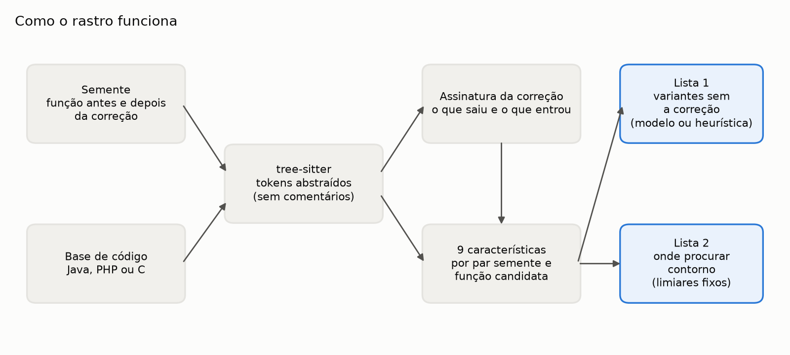
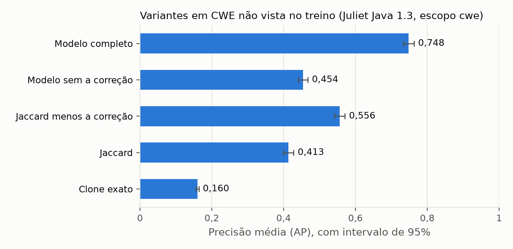

# rastro

*[Versão em português](README.md)*

When a vulnerability is fixed, the fix closes that one spot. The next question for whoever owns a
product's security is whether the same flaw lives somewhere else in the code. PHP is the textbook
case: CVE-2024-4577 is CVE-2012-1823 coming back, through a path the 2012 fix did not cover.



rastro does that search. Given a seed (the vulnerable function and the same function fixed) and a
codebase, it returns two lists: the functions most similar to the flaw and **least similar to the
fix**, and the ones that already received the fix, where a bypass may hide.

Undergraduate thesis by Fabrício Júnio.

## Results

Experiment on the full NIST [Juliet Test Suite for Java 1.3](https://samate.nist.gov/SARD/test-suites/111)
(55,357 methods), with cross-validation grouped by CWE: the model is tested on vulnerability
classes it never saw in training. `cwe` scope, 870 seeds across 61 CWEs:

| Scorer | AP [95% CI] | MRR | Fixed code in top 10 |
|---|---|---|---|
| Exact clone (VUDDY-style) | 0.160 [0.156, 0.164] | 0.349 | 38.9% |
| Jaccard | 0.413 [0.400, 0.428] | 0.776 | 36.4% |
| Jaccard minus fix | 0.556 [0.542, 0.571] | 0.832 | 9.0% |
| Model without fix features | 0.454 [0.441, 0.468] | 0.771 | 27.6% |
| **Full model** | **0.748 [0.733, 0.763]** | **0.896** | **2.6%** |



With Jaccard, over a third of the top 10 is code that was already fixed; with the full model,
2.6%. Removing only the features that look at the fix brings that back to 27.6%, so the gain comes
from the fix signature, and the two most important features by permutation are its own. Every
difference has p < 10⁻⁶ in a paired Wilcoxon test, and the result holds with 2- and 4-token
n-grams (AP 0.775 and 0.765).

In both real cases, PHP (CVE-2012-1823 and CVE-2024-4577) and Spring (CVE-2010-1622 and
Spring4Shell), the same idea shows its limit: the second flaw sits where the first fix was
applied, and a scorer that demotes fixed code ranks it last. That is why rastro returns the second
list, and both locations show up there. Spring's unfixed variant (`introspectInterfaces`) ranks 3rd
of 17 in the first list. The model trained on Juliet did not transfer reliably to these cases, so
the default for `rastro variantes` is the heuristic.

On whole repositories, rastro analyses the 16,845 functions of `php-src` in 24 seconds and the
75,712 of `spring-framework` in 22, under 700 MB of memory, on a standard GitHub Actions runner.

Details, intervals and per-CWE analysis in [docs/resultados.md](docs/resultados.md); method and
related work (VUDDY, MVP, MOVERY, V1SCAN, FIRE, PrimeVul) in
[docs/metodologia.md](docs/metodologia.md). Both are in Portuguese.

## Usage

Python 3.11.

```bash
python -m venv .venv
. .venv/bin/activate            # on Windows: .venv\Scripts\activate
pip install --require-hashes --no-deps -r requisitos/dev.txt
pip install --no-deps -e .
```

Look for variants of a flaw in a folder:

```bash
rastro variantes --id CVE-2012-1823 --linguagem c \
  --vulneravel before.c --corrigido after.c --alvo ../php-src/sapi --top 20
```

Without a model it uses the fix-aware heuristic, instantly. With `--treinar-com
dados/juliet-java-1.3.zip` it trains the model before ranking. No model is ever loaded from a file:
unpickling runs code, and a security tool should not do that
([ADR 0003](docs/adr/0003-sem-modelo-serializado.md)).

Reproduce the results:

```bash
rastro experimento --baixar --escopo cwe --saida resultados/juliet-cwe.json
rastro caso php
rastro caso spring --treinar-com dados/juliet-java-1.3.zip
```

`--baixar` fetches Juliet from NIST SARD over HTTPS and only uses it after checking the SHA-256
pinned in the code. `caso php` fetches the three `php-src` files at the exact commits and checks the
hash of each one.

## Tests

```bash
pytest
ruff check src tests && ruff format --check src tests
mypy src tests
```

111 tests, 99% branch coverage, strict mypy. CI runs this on every push, plus gitleaks, OSV-Scanner
and Semgrep, and the full experiment on pull requests to production.

## Limitations

- Juliet is synthetic. It gives reliable labels and hard negatives (the `good()` next to the
  `bad()`), but real code is more varied, and in the `familia` scope Jaccard already saturates.
- Function-level comparison does not see flaws that span methods. Only Juliet flows 01 to 19 are
  used.
- The model is trained on Java. PHP and C are parsed but have no labelled set in the experiment yet.
- Incomplete fixes: ranking demotes the bypass location, which only appears in the bypass list.
- The model's gain on Juliet did not transfer reliably to the two real cases.

## Use of AI

This project was structured with the help of generative AI tools. Modelling, business rules, code
review and conclusions were reviewed and validated by Fabrício Júnio.

## Author

Fabrício Júnio · [GitHub](https://github.com/fabriciojunio)
