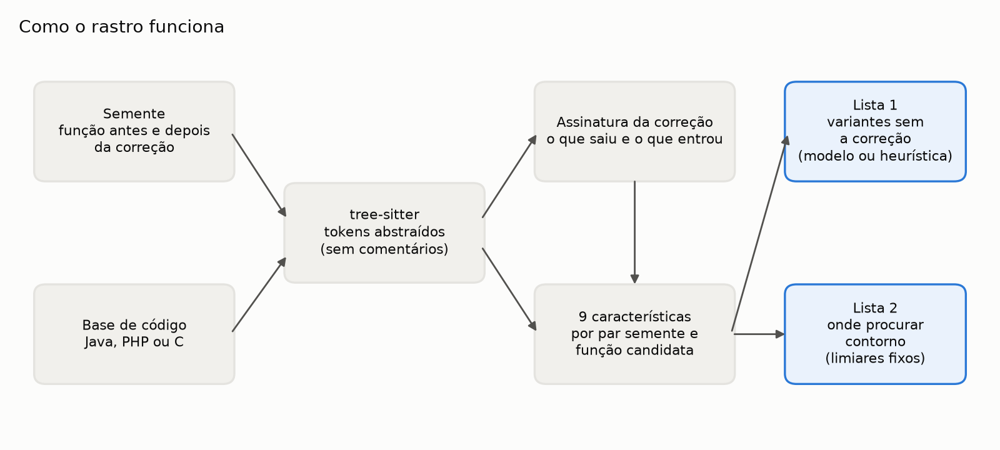
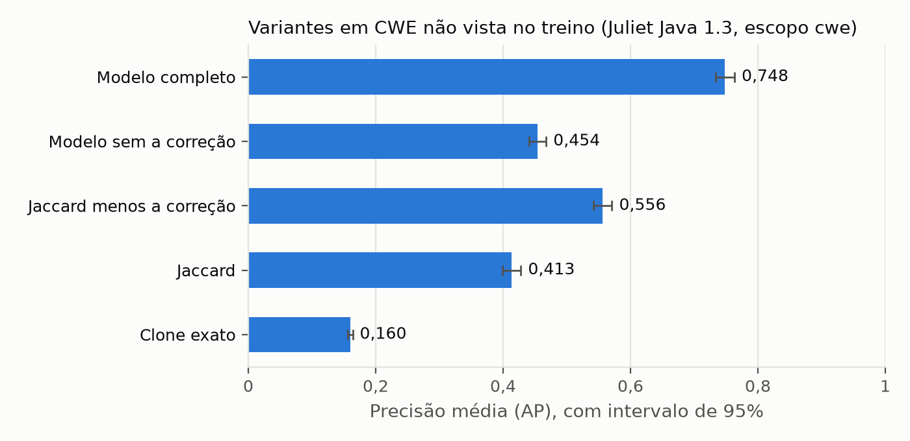

# rastro

*[Read this in English](README.en.md)*

Quando sai uma vulnerabilidade, a correção fecha aquele ponto. A pergunta seguinte de quem cuida da
segurança de um produto é se a mesma falha existe em outro lugar do código. Foi assim com o PHP: a
CVE-2024-4577 é a CVE-2012-1823 de volta, por um caminho que a correção de 2012 não cobriu.



O rastro faz essa busca. Recebe a semente (a função vulnerável e a mesma função corrigida) e uma
base de código, e devolve duas listas: as funções mais parecidas com a falha e **menos parecidas
com a correção**, e as que receberam a correção, onde se procura contorno.

Pesquisa em Product Security de Fabrício Júnio.

## Resultado

Experimento sobre a [Juliet Test Suite para Java 1.3](https://samate.nist.gov/SARD/test-suites/111)
do NIST inteira (55.357 métodos), com validação cruzada por CWE: o modelo é testado em classes de
falha que não viu no treino. Escopo `cwe`, 870 sementes em 61 CWEs:

| Pontuador | AP [IC 95%] | MRR | Corrigidos no top 10 |
|---|---|---|---|
| Clone exato (estilo VUDDY) | 0,160 [0,156; 0,164] | 0,349 | 38,9% |
| Jaccard | 0,413 [0,400; 0,428] | 0,776 | 36,4% |
| Jaccard menos a correção | 0,556 [0,542; 0,571] | 0,832 | 9,0% |
| Modelo sem as características da correção | 0,454 [0,441; 0,468] | 0,771 | 27,6% |
| **Modelo completo** | **0,748 [0,733; 0,763]** | **0,896** | **2,6%** |



No Jaccard, mais de um terço do top 10 é código que já foi corrigido; no modelo completo, 2,6%.
Tirar do modelo só as características que olham a correção leva esse número a 27,6%, então o ganho
vem da assinatura da correção, e as duas características mais importantes por permutação são as
dela. Todas as diferenças têm p < 10⁻⁶ no teste de Wilcoxon pareado, e o resultado se mantém com
n-gramas de 2 e 4 tokens (AP 0,775 e 0,765).

Nos dois casos reais, PHP (CVE-2012-1823 e CVE-2024-4577) e Spring (CVE-2010-1622 e Spring4Shell),
o mesmo critério mostra o seu limite: a segunda falha está no lugar que já recebeu a primeira
correção, e quem rebaixa o código corrigido o põe em último. É por isso que o rastro devolve a
segunda lista, e nela os dois lugares aparecem. A variante sem correção do Spring
(`introspectInterfaces`) fica em 3º de 17 na primeira lista. O modelo treinado na Juliet não se
transferiu de forma estável para esses casos, e por isso o padrão do `rastro variantes` é a
heurística.

No repositório inteiro, o rastro analisa as 16.845 funções do `php-src` em 24 segundos e as
75.712 do `spring-framework` em 22, abaixo de 700 MB de memória, numa máquina padrão do GitHub
Actions.

Detalhe, intervalos e análise por CWE em [docs/resultados.md](docs/resultados.md); método e
trabalhos relacionados (VUDDY, MVP, MOVERY, V1SCAN, FIRE, PrimeVul) em
[docs/metodologia.md](docs/metodologia.md).

## Como usar

Python 3.11.

```bash
python -m venv .venv
. .venv/bin/activate            # no Windows: .venv\Scripts\activate
pip install --require-hashes --no-deps -r requisitos/dev.txt
pip install --no-deps -e .
```

Procurar variantes de uma falha numa pasta:

```bash
rastro variantes --id CVE-2012-1823 --linguagem c \
  --vulneravel antes.c --corrigido depois.c --alvo ../php-src/sapi --top 20
```

Sem modelo, usa a heurística com a correção, na hora. Com `--treinar-com dados/juliet-java-1.3.zip`,
treina o modelo antes de ranquear. Nenhum modelo é carregado de arquivo: desserializar `pickle`
executa código, e uma ferramenta de segurança não aceita isso
([ADR 0003](docs/adr/0003-sem-modelo-serializado.md)).

Reproduzir os resultados:

```bash
rastro experimento --baixar --escopo cwe --saida resultados/juliet-cwe.json
rastro caso php
rastro caso spring --treinar-com dados/juliet-java-1.3.zip
```

O `--baixar` busca a Juliet no NIST SARD por HTTPS e só usa o arquivo depois de conferir o SHA-256
fixado no código. O `caso php` baixa os três arquivos do `php-src` nos commits exatos e confere o
hash de cada um.

## Testes

```bash
pytest
ruff check src tests && ruff format --check src tests
mypy src tests
```

111 testes, 99% de cobertura de ramos, mypy estrito. A CI roda isso a cada push, mais gitleaks,
OSV-Scanner e Semgrep, e o experimento completo no PR para produção.

## Como está organizado

```
src/rastro/
  dominio/          semente, n-gramas e assinatura da correção (sem dependência externa)
  aplicacao/        características do par, pontuadores e lista de contornos
  avaliacao/        métricas, experimento, estatística e casos reais
  infraestrutura/   tree-sitter (Java, PHP e C), leitura da Juliet e download conferido
  interfaces/       linha de comando
```

As decisões estão em [docs/adr/](docs/adr/).

## Limitações

- A Juliet é sintética. Ela dá rótulo confiável e negativos difíceis (o `good()` ao lado do
  `bad()`), mas o código real é mais variado, e no escopo `familia` o Jaccard já satura.
- Comparação por função não vê falha que atravessa métodos. Só os fluxos de 01 a 19 da Juliet
  entram.
- O modelo é treinado em Java. PHP e C são analisados, mas sem conjunto rotulado no experimento.
- Correção incompleta: o ranqueamento rebaixa o lugar do contorno, e ele só aparece na lista de
  contornos.
- O ganho do modelo na Juliet não se transferiu de forma estável para os dois casos reais.

## Uso de IA

Este projeto foi estruturado com apoio de ferramentas de IA generativa. Modelagem, regras de
negócio, revisão do código e conclusões foram revisadas e validadas por Fabrício Júnio.

## Autor

Fabrício Júnio · [GitHub](https://github.com/fabriciojunio)
