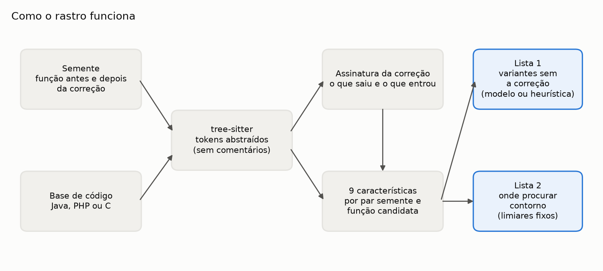
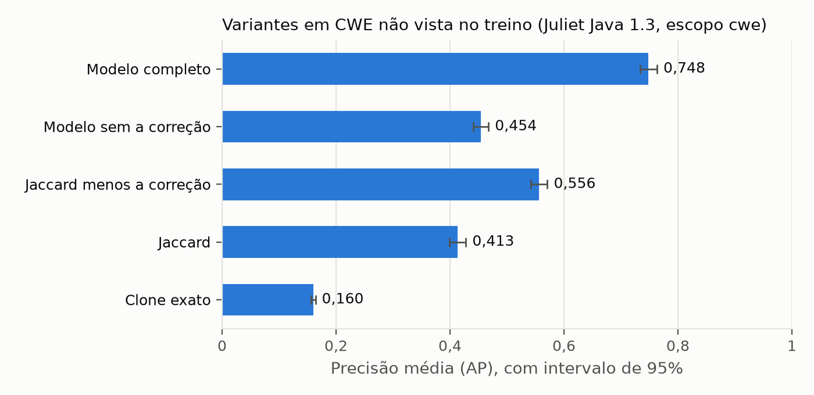
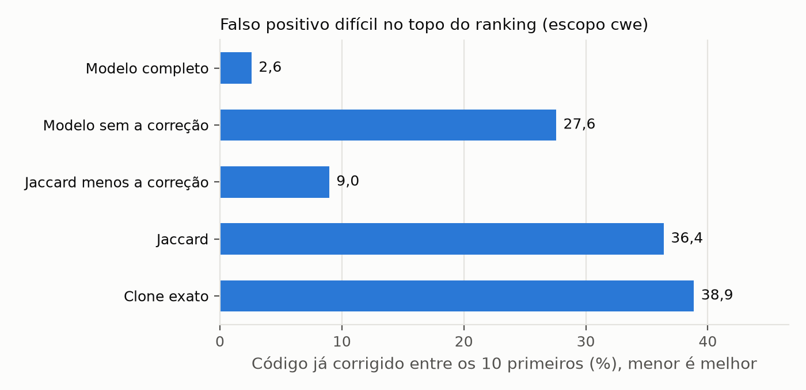
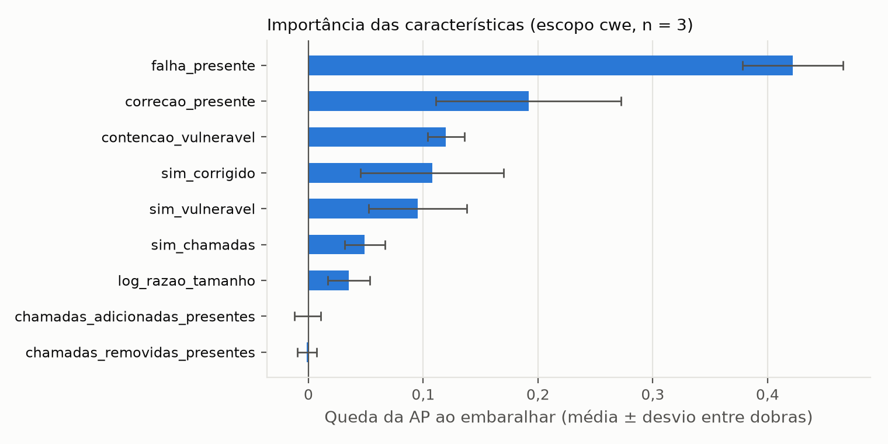
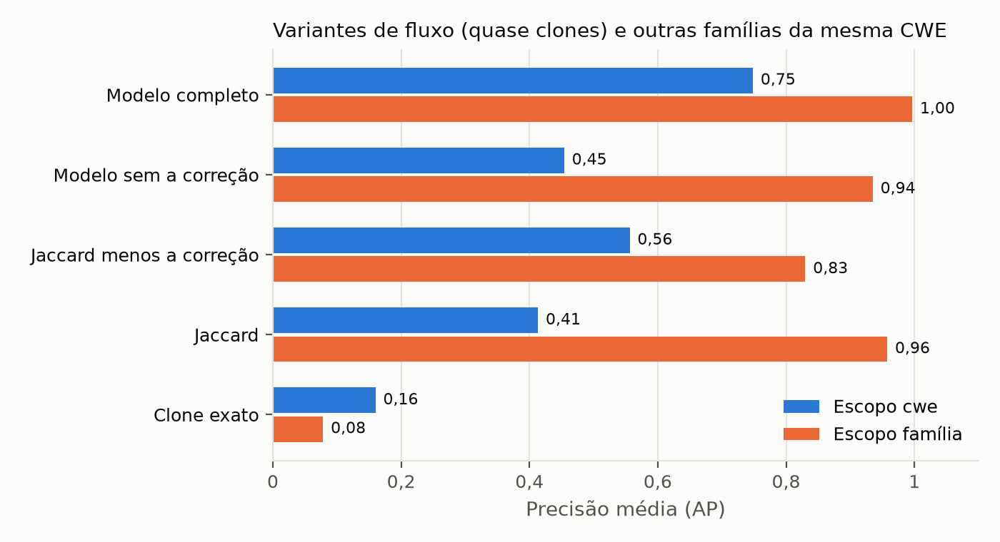
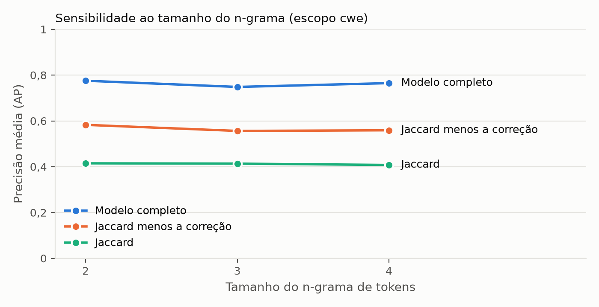

# rastro: análise de variantes de vulnerabilidades com aprendizado de máquina e assinatura da correção

Fabrício Júnio

Relatório da pesquisa em Markdown. Números e tabelas
vêm de [resultados.md](resultados.md); o método detalhado está em [metodologia.md](metodologia.md).

## Resumo

Quando uma vulnerabilidade é corrigida, a mesma falha costuma existir em outros pontos do código, e
às vezes no próprio ponto corrigido, por um caminho que a correção não cobriu. Procurar essas
variantes a partir de uma falha conhecida é rotina de quem cuida da segurança de um produto. Este
trabalho apresenta o rastro, uma ferramenta que recebe a função vulnerável e a mesma função
corrigida e ranqueia as funções de uma base de código pela chance de serem variantes ainda
vulneráveis. O rastro combina a semelhança com a falha e a assinatura da correção (o que a correção
removeu e o que acrescentou) num modelo de gradient boosting. Na Juliet Test Suite para Java do
NIST, com validação cruzada que testa o modelo em classes de falha que ele não viu, o modelo chegou
a precisão média de 0,748, contra 0,413 da semelhança simples, e reduziu o código já corrigido entre
os dez primeiros resultados de 36,4% para 2,6%. Sem as características da correção, o mesmo modelo
deixou 27,6% de código corrigido no topo. Em dois casos reais, PHP (CVE-2012-1823 e CVE-2024-4577)
e Spring (CVE-2010-1622 e CVE-2022-22965), a segunda falha estava no lugar que tinha recebido a
primeira correção, o que mostrou um limite do método e levou a uma segunda saída, a lista de
lugares onde procurar contorno, que apontou os dois. O ganho do modelo na Juliet não se transferiu
de forma estável para os casos reais. A ferramenta analisa repositórios inteiros, como o php-src e
o spring-framework, em menos de um minuto.

**Palavras-chave:** segurança de software; análise de variantes; vulnerabilidade recorrente;
aprendizado de máquina; correção incompleta.

## Abstract

When a vulnerability is fixed, the same flaw often lives elsewhere in the code, and sometimes in
the fixed spot itself, through a path the fix did not cover. Looking for these variants from a
known flaw is routine work for product security teams. This work presents rastro, a tool that takes
the vulnerable function and the same function fixed and ranks the functions of a codebase by how
likely they are to be still-vulnerable variants. rastro combines similarity to the flaw with the
fix signature (what the fix removed and what it added) in a gradient boosting model. On NIST's
Juliet Test Suite for Java, with cross-validation that tests the model on vulnerability classes it
never saw, the model reached an average precision of 0.748, against 0.413 for plain similarity, and
cut already-fixed code in the top ten from 36.4% to 2.6%. Without the fix features, the same model
left 27.6% of fixed code at the top. In two real cases, PHP (CVE-2012-1823 and CVE-2024-4577) and
Spring (CVE-2010-1622 and CVE-2022-22965), the second flaw was in the place that had received the
first fix, which exposed a limit of the method and led to a second output, a list of places to look
for bypasses, which pointed to both. The model's gain on Juliet did not transfer reliably to the
real cases. The tool analyses whole repositories such as php-src and spring-framework in under a
minute.

**Keywords:** software security; variant analysis; recurring vulnerability; machine learning;
incomplete fix.

## 1 Introdução

### 1.1 Contexto

Uma correção de segurança fecha o ponto em que a falha foi encontrada. O mesmo erro, porém, raramente
existe num lugar só: o código foi copiado, o mesmo padrão foi usado por outra pessoa em outro
módulo, ou a correção cobriu o caminho do ataque que foi reportado e deixou outro aberto. Por isso,
depois de cada vulnerabilidade, a pergunta de quem cuida da segurança de um produto é onde mais essa
falha está. A essa busca dá-se o nome de análise de variantes, e a documentação do CodeQL a define
como usar uma vulnerabilidade conhecida como semente para encontrar problemas parecidos no código
(GITHUB, 2026).

O caso do PHP mostra o problema. Em 2012, a CVE-2012-1823 permitia passar opções de linha de
comando ao `php-cgi` pela query string, e a correção fez o programa deixar de interpretar opções
quando a query string decodificada começa com hífen e não tem sinal de igual. Em 2024, a
CVE-2024-4577 mostrou que, em Windows com certas páginas de código, o hífen suave (byte 0xAD) passa
pela checagem, que olha a query string, e vira hífen comum na conversão "Best-Fit" dos argumentos,
como registra a mensagem do commit que corrigiu a falha. A mesma injeção volta, e a falha nova
estava na mesma função que tinha recebido a correção antiga.

### 1.2 Problema

As ferramentas que procuram código vulnerável parecido com uma falha conhecida usam semelhança de
código (KIM et al., 2017). Semelhança acha o que parece com a falha e, pelo mesmo motivo, acha o
código que já foi corrigido, que continua parecido. Do outro lado, os modelos de aprendizado de
máquina que tentam dizer se uma função qualquer é vulnerável caem de 68% para 3% de F1 quando
avaliados num conjunto com rótulo confiável (DING et al., 2025). O problema deste trabalho fica
entre os dois: dada uma vulnerabilidade com o código antes e depois da correção, ranquear as
funções de uma base de código de forma que as variantes ainda vulneráveis apareçam antes do código
parecido que já foi corrigido.

### 1.3 Objetivos

**Objetivo geral.** Construir e avaliar uma ferramenta de análise de variantes que combine
semelhança com a falha e assinatura da correção num modelo aprendido.

**Objetivos específicos.**

1. Representar funções de Java, PHP e C de forma comparável, tolerante a nomes de variável
   diferentes e sem vazar o rótulo do conjunto de avaliação.
2. Definir características que meçam a semelhança com a falha, com a correção e a presença do que a
   correção removeu e acrescentou.
3. Comparar o modelo com clone de código, semelhança simples e uma heurística sem aprendizado, em
   classes de falha não vistas no treino (RQ1).
4. Medir quanto as características da correção reduzem o código já corrigido no topo (RQ2).
5. Aplicar a ferramenta a casos reais de falha recorrente (RQ3).
6. Medir o custo de rodar a ferramenta num repositório inteiro (RQ4).

### 1.4 Justificativa

Análise de variantes é parte do trabalho de equipes de segurança de produto e de resposta a
incidentes de produto. Uma ferramenta que ponha as variantes antes do código já corrigido reduz o
tempo dessa revisão e o risco de a mesma falha voltar depois de uma correção. O trabalho também
tem valor de método: mede, com controle de vazamento e teste estatístico, quanto a assinatura da
correção explica, e mostra onde ela falha.

## 2 Fundamentação

### 2.1 Vulnerabilidade, CWE e CVE

Uma vulnerabilidade é uma falha de software que um atacante pode explorar. O CVE (Common
Vulnerabilities and Exposures) dá um identificador a cada vulnerabilidade publicada, e o CWE
(Common Weakness Enumeration) classifica o tipo de falha, como injeção de SQL (CWE-89) ou estouro de
inteiro (CWE-190). Uma mesma CWE aparece em código muito diferente; é essa variedade que torna a
busca por variantes difícil.

### 2.2 Correção incompleta e falha recorrente

Uma correção é incompleta quando fecha o caminho de ataque reportado e deixa outro aberto para a
mesma falha. A falha recorrente é a mesma vulnerabilidade em outro lugar, por reuso de código ou
por repetição do mesmo erro. Os dois casos reais deste trabalho são correções incompletas.

### 2.3 Detecção de clone de código

Clones de código são trechos iguais ou parecidos. A classificação usual distingue clones idênticos
(tipo 1), idênticos a menos de nomes e literais (tipo 2) e com linhas acrescentadas ou removidas
(tipo 3). O VUDDY usa clones de tipo 2 por função, com abstração de identificadores, para encontrar
código vulnerável copiado em escala (KIM et al., 2017).

### 2.4 Aprendizado de máquina para ranqueamento

O rastro trata a busca como ranqueamento: cada par (semente, candidato) recebe uma nota, e a lista
é ordenada por ela. A nota é a probabilidade dada por um classificador de gradient boosting
(FRIEDMAN, 2001), na implementação do scikit-learn (PEDREGOSA et al., 2011). A importância de cada
característica é medida por permutação (BREIMAN, 2001): quanto o desempenho cai quando a coluna é
embaralhada.

### 2.5 Avaliação de ranqueamento

A precisão média (AP) resume a qualidade de toda a lista; o MRR olha a posição do primeiro acerto;
recall e precisão em k olham o topo, que é o que uma pessoa lê. O intervalo de confiança das médias
é obtido por bootstrap (EFRON; TIBSHIRANI, 1993), e as comparações entre métodos usam o teste de
postos sinalizados de Wilcoxon (WILCOXON, 1945), pareado por semente.

## 3 Trabalhos relacionados

O VUDDY (KIM et al., 2017) encontra clones de funções vulneráveis em escala de bilhões de linhas,
mas só olha a falha. O MVP (XIAO et al., 2020) é o trabalho mais próximo: gera uma assinatura da
vulnerabilidade e uma do patch, por fatiamento de programa, e marca a função que casa a primeira e
não casa a segunda, com regras de casamento definidas pelos autores, para C. O MOVERY (WOO et al.,
2022) e o V1SCAN (WOO et al., 2023) tratam de código de terceiros reutilizado com modificação,
também em C e C++. O FIRE (FENG et al., 2024) combina filtros em estágios com análise de
contaminação. O PrimeVul (DING et al., 2025) mostra que modelos de linguagem de código avaliados
em conjuntos com rótulo confiável ficam perto do aleatório na detecção geral de vulnerabilidades.

O rastro parte da ideia do MVP, que é usar a correção, e se diferencia em quatro pontos: a
combinação é aprendida, não escrita à mão; a avaliação é feita em classes de falha não vistas no
treino; a contribuição da assinatura da correção é isolada por ablação, com teste estatístico; e a
ferramenta trabalha com Java, PHP e C por meio de um analisador comum.

## 4 Metodologia

### 4.1 Visão geral

A Figura 1 mostra o funcionamento do rastro. A semente (a função antes e depois da correção) e a
base de código passam pelo mesmo analisador, que transforma cada função numa sequência de tokens
abstraídos. Da semente sai a assinatura da correção. Para cada função candidata calculam-se nove
características do par, que alimentam o modelo ou a heurística (Lista 1) e os limiares que
identificam os lugares que já receberam a correção (Lista 2).

**Figura 1 – Funcionamento do rastro**

Fonte: elaborado pelo autor (2026).

### 4.2 Representação do código

O código é lido com o tree-sitter, que tem gramática para Java, PHP e C. Cada função vira uma
sequência de tokens em que nomes de variáveis viram `ID`, textos viram `STR` e números viram `NUM`,
à maneira do VUDDY (KIM et al., 2017). O nome das funções chamadas e o dos tipos ficam com o texto
original, porque caracterizam a falha. Comentários e o nome da própria função são descartados:
na Juliet os comentários dizem "POTENTIAL FLAW" e "FIX", e o nome da função (`bad`, `goodG2B`)
entrega o rótulo. A comparação usa trigramas de tokens.

### 4.3 Assinatura da correção e características

A assinatura da correção é formada pelo conjunto de trigramas que a correção removeu e pelo que ela
acrescentou. As nove características do par (semente, candidato) são: semelhança de Jaccard com o
código vulnerável e com o corrigido; contenção dos trigramas vulneráveis no candidato; fração dos
trigramas removidos e dos acrescentados presentes no candidato; semelhança dos nomes de função
chamados; fração das chamadas removidas e acrescentadas presentes; e o logaritmo da razão de
tamanho.

### 4.4 Métodos comparados

Foram comparados cinco pontuadores: o clone exato, no estilo do VUDDY; a semelhança de Jaccard; a
heurística "Jaccard menos a correção", sem aprendizado; o modelo de gradient boosting só com as
características que não olham a correção (ablação); e o modelo completo, com as nove. O modelo é o
`HistGradientBoostingClassifier` do scikit-learn, com 200 iterações, taxa de aprendizado 0,1 e peso
de classe balanceado, sem busca de hiperparâmetros.

### 4.5 Dados

O gabarito é a Juliet Test Suite para Java 1.3 do NIST (BOLAND; BLACK, 2012), baixada do SARD e
conferida pelo SHA-256. Em cada arquivo de caso, `bad()` tem a falha e os `good*()` são o mesmo
código corrigido. Família é a CWE com a variante funcional; a semente é o `bad()` do fluxo 01 com a
correção que corrige o uso do dado. Foram usados os fluxos de 01 a 19, em que a falha cabe numa
função: 55.357 métodos rotulados.

Em dois escopos: no escopo família, os parentes da semente são as outras variantes de fluxo da
mesma família; no escopo cwe, são até 300 funções de outras famílias da mesma CWE, sem a própria.
Em ambos entram 200 funções sorteadas de outras CWEs.

### 4.6 Avaliação

Validação cruzada em cinco dobras agrupadas por CWE, de modo que o modelo é sempre testado em
classes de falha que não viu. No treino saem até os candidatos que vêm das CWEs de teste. Para cada
semente medem-se a precisão média (AP), o MRR, recall e precisão nos dez primeiros e a fração dos
dez primeiros que é código já corrigido. As médias vêm com intervalo de 95% por bootstrap e as
comparações usam o teste de Wilcoxon pareado por semente. Tudo roda na integração contínua com
semente aleatória fixa, e duas execuções separadas deram os mesmos números.

## 5 Resultados

### 5.1 RQ1: ranqueamento de variantes

No escopo cwe, com 870 sementes em 61 CWEs, o modelo completo obteve precisão média de 0,748,
contra 0,413 do Jaccard e 0,160 do clone exato (Figura 2). Os intervalos de confiança não se cruzam,
e todas as diferenças têm p < 10⁻⁶ no teste de Wilcoxon.

**Figura 2 – Precisão média por método, escopo cwe**

Fonte: elaborado pelo autor (2026), com dados da execução 41537500845 da integração contínua.

### 5.2 RQ2: código já corrigido no topo

Entre os dez primeiros resultados do Jaccard, 36,4% são código já corrigido; no modelo completo,
2,6% (Figura 3). O mesmo modelo, sem as características que olham a correção, deixa 27,6%.

**Figura 3 – Código já corrigido entre os dez primeiros resultados**

Fonte: elaborado pelo autor (2026).

A importância por permutação confirma o resultado por outro caminho: as duas características mais
importantes são as da assinatura da correção (Figura 4).

**Figura 4 – Importância das características**

Fonte: elaborado pelo autor (2026).

### 5.3 Os dois escopos e a sensibilidade

No escopo família, o Jaccard chega a 0,958 de precisão média, porque as variantes de fluxo são
quase clones; no escopo cwe, cai para 0,413 (Figura 5). O resultado principal não depende do
tamanho do n-grama: com 2, 3 e 4 tokens o modelo fica entre 0,748 e 0,775 (Figura 6).

**Figura 5 – Precisão média nos dois escopos**

Fonte: elaborado pelo autor (2026).

**Figura 6 – Sensibilidade ao tamanho do n-grama**

Fonte: elaborado pelo autor (2026).

### 5.4 RQ3: casos reais

**Quadro 1 – Posição dos lugares corrigidos pela segunda correção**

| Método | PHP `main` (contorno) | Spring construtor (contorno) | Spring `introspectInterfaces` (variante) |
|---|---|---|---|
| Clone exato | 44 de 44 | 17 de 17 | 17 de 17 |
| Jaccard | 1 de 44 | 1 de 17 | 3 de 17 |
| Jaccard menos a correção | 44 de 44 | 17 de 17 | 3 de 17 |
| Modelo treinado na Juliet | 39 de 44 | 1 de 17 | 12 de 17 |
| Na lista de contornos | sim | sim | não |

Fonte: elaborado pelo autor (2026).

Nos dois casos, a segunda falha estava no lugar que tinha recebido a primeira correção, e a lista
de contornos o apontou. A variante sem correção do Spring ficou em 3º de 17 com a heurística. Num
projeto do próprio autor, o brecha, os três métodos com controle de acesso quebrado ficaram nas três
primeiras posições entre 99 funções.

### 5.5 RQ4: custo

**Tabela 1 – Custo em repositório inteiro**

| Repositório | Funções | Tempo | Memória |
|---|---|---|---|
| php-src | 16.845 | 24,0 s | 381 MB |
| spring-framework | 75.712 | 21,8 s | 670 MB |

Fonte: elaborado pelo autor (2026), executor padrão do GitHub Actions.

## 6 Discussão

**O ganho vem da correção, e isso foi medido de dois jeitos.** Tirar do modelo as características
que olham a correção faz o código corrigido no topo subir de 2,6% para 27,6% (ablação), e as duas
características mais importantes por permutação são justamente `falha_presente` e
`correcao_presente`. As duas medidas são independentes e apontam para o mesmo lado. A heurística
sem aprendizado (semelhança com a falha menos semelhança com a correção) já leva o código corrigido
no topo a 9,0%, então a maior parte do efeito é da ideia, e o modelo acrescenta sobre ela: precisão
média de 0,556 para 0,748.

**O resultado não depende de ajuste fino.** Com n-gramas de 2, 3 e 4 tokens, o modelo fica entre
0,748 e 0,775 de precisão média e o Jaccard em torno de 0,41. O valor 3 foi fixado antes e não é o
melhor dos três. Duas execuções separadas deram os mesmos números.

**A Juliet é fácil num escopo e difícil no outro.** Quando os parentes da semente são as variantes
de fluxo da mesma família, o Jaccard chega a 0,958 de precisão média: o código é quase o mesmo, com
outra estrutura de controle em volta. O escopo que representa o problema real é o de outras
famílias da mesma CWE, e foi nele que a assinatura da correção fez diferença. Reportar só o
primeiro escopo daria um resultado bonito e sem significado.

**Correção incompleta é o limite.** Nos dois casos reais a segunda falha estava no lugar que tinha
recebido a primeira correção. Um método que rebaixa o código corrigido rebaixa esse lugar; o MVP,
que usa a mesma ideia com regras, tem o mesmo limite por construção. A resposta foi separar a
saída em duas listas, e a segunda, de lugares que receberam a correção, apontou os dois lugares
certos, com um único item no repositório inteiro do Spring.

**O modelo não transferiu de forma estável.** Treinado na Juliet, ele acertou um dos três lugares
esperados nos casos reais. Com dois casos não se pode concluir nada geral, mas é um aviso coerente
com o PrimeVul: ganho em conjunto sintético não é ganho garantido em código real. Por isso a
ferramenta usa a heurística por padrão e deixa o modelo como opção.

**O ranqueamento se dilui em repositório grande.** No arquivo do Spring, a variante sem correção
ficou em 3º de 17; no repositório inteiro, acima da posição 1.000, entre 75.712 funções. Para uma
semente grande e genérica, o ranqueamento ajuda a escolher por onde começar dentro de um módulo, e
não a apontar uma linha num repositório inteiro.

## 7 Conclusão

O trabalho mostrou que combinar semelhança com a falha e assinatura da correção num modelo aprendido
ranqueia variantes melhor que clone de código e semelhança simples, em classes de falha que o
modelo não viu: precisão média de 0,748 contra 0,413 do Jaccard e 0,160 do clone exato, com o
código já corrigido entre os dez primeiros caindo de 36,4% para 2,6% (RQ1 e RQ2, Juliet Java 1.3,
p < 10⁻⁶). Mostrou também onde a ideia falha: na correção incompleta, em que a nova falha mora no
lugar já corrigido. A lista de lugares onde procurar contorno respondeu a esse limite nos dois
casos reais (RQ3). A ferramenta analisa repositórios com dezenas de milhares de funções em menos
de meio minuto numa máquina padrão de integração contínua (RQ4).

Como trabalho futuro ficam um conjunto real rotulado com mais casos de correção incompleta, a
comparação por fatia de programa em vez de função inteira, para alcançar falhas que atravessam
métodos, e o treino com PHP e C.

## Referências

BOLAND, F. E.; BLACK, P. E. Juliet 1.1 C/C++ and Java Test Suite. **Computer**, v. 45, n. 10,
p. 88-90, out. 2012. DOI: 10.1109/MC.2012.345.

BREIMAN, L. Random Forests. **Machine Learning**, v. 45, n. 1, p. 5-32, 2001.

DING, Y. et al. Vulnerability Detection with Code Language Models: How Far Are We? In:
INTERNATIONAL CONFERENCE ON SOFTWARE ENGINEERING, 47., 2025, Ottawa. **Proceedings** [...].
Piscataway: IEEE, 2025. p. 1729-1741. DOI: 10.1109/ICSE55347.2025.00038.

EFRON, B.; TIBSHIRANI, R. J. **An Introduction to the Bootstrap**. New York: Chapman & Hall, 1993.

FENG, S. et al. FIRE: Combining Multi-Stage Filtering with Taint Analysis for Scalable Recurring
Vulnerability Detection. In: USENIX SECURITY SYMPOSIUM, 33., 2024, Philadelphia.
**Proceedings** [...]. Berkeley: USENIX Association, 2024. p. 1867-1884.

FRIEDMAN, J. H. Greedy function approximation: a gradient boosting machine. **The Annals of
Statistics**, v. 29, n. 5, p. 1189-1232, 2001.

GITHUB. **About CodeQL**. Disponível em:
https://codeql.github.com/docs/codeql-overview/about-codeql/. Acesso em: 2 nov. 2026.

KIM, S. et al. VUDDY: A Scalable Approach for Vulnerable Code Clone Discovery. In: IEEE SYMPOSIUM
ON SECURITY AND PRIVACY, 2017, San Jose. **Proceedings** [...]. Los Alamitos: IEEE, 2017.
p. 595-614.

PEDREGOSA, F. et al. Scikit-learn: Machine Learning in Python. **Journal of Machine Learning
Research**, v. 12, p. 2825-2830, 2011.

WILCOXON, F. Individual Comparisons by Ranking Methods. **Biometrics Bulletin**, v. 1, n. 6,
p. 80-83, 1945.

WOO, S. et al. MOVERY: A Precise Approach for Modified Vulnerable Code Clone Discovery from
Modified Open-Source Software Components. In: USENIX SECURITY SYMPOSIUM, 31., 2022, Boston.
**Proceedings** [...]. Berkeley: USENIX Association, 2022. p. 3037-3053.

WOO, S. et al. V1SCAN: Discovering 1-day Vulnerabilities in Reused C/C++ Open-source Software
Components Using Code Classification Techniques. In: USENIX SECURITY SYMPOSIUM, 32., 2023,
Anaheim. **Proceedings** [...]. Berkeley: USENIX Association, 2023. p. 6541-6556.

XIAO, Y. et al. MVP: Detecting Vulnerabilities using Patch-Enhanced Vulnerability Signatures. In:
USENIX SECURITY SYMPOSIUM, 29., 2020. **Proceedings** [...]. Berkeley: USENIX Association, 2020.
p. 1165-1182.
