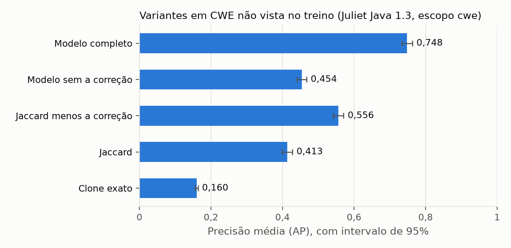
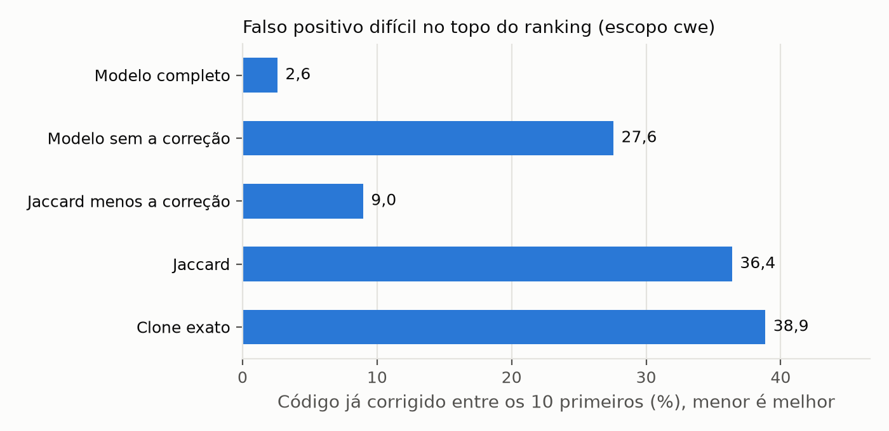
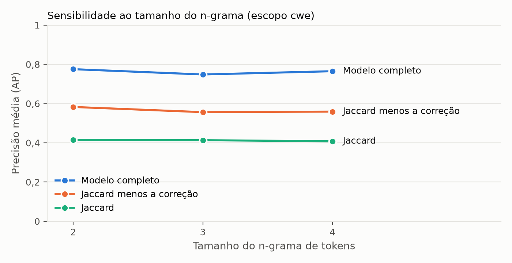
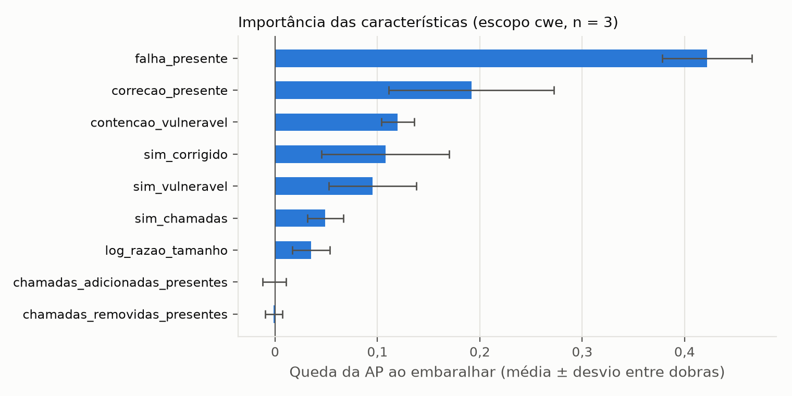
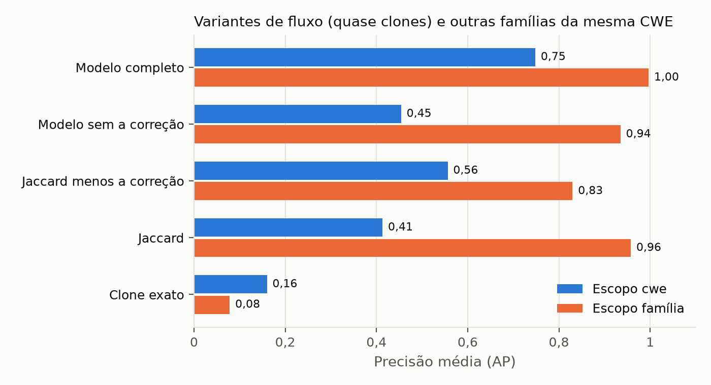

# Resultados

Execução da CI [41537500845](https://github.com/fabriciojunio/rastro/actions/runs/41537500845),
commit `2ef14ba`, Juliet Java 1.3 inteira (SHA-256 conferido), 55.357 métodos rotulados. O JSON
completo, com a linha de cada semente, fica como artefato da execução; o resumo está em
[`dados/`](dados/). Métricas definidas na [metodologia](metodologia.md#8-avaliação).

A execução anterior ([41530095425](https://github.com/fabriciojunio/rastro/actions/runs/41530095425),
commit `a75107d`) deu exatamente os mesmos números no escopo `cwe` com n-grama 3: o experimento é
determinístico, com semente aleatória fixa.

## RQ1 e RQ2, escopo `cwe`

870 sementes em 61 CWEs. Os parentes são outras famílias da mesma CWE: a mesma falha escrita em
outro código. É o resultado principal.

| Pontuador | AP [IC 95%] | MRR | Precisão@10 | Corrigidos no top 10 |
|---|---|---|---|---|
| Clone exato | 0,160 [0,156; 0,164] | 0,349 | 0,148 | 38,9% |
| Jaccard | 0,413 [0,400; 0,428] | 0,776 | 0,525 | 36,4% |
| Jaccard menos a correção | 0,556 [0,542; 0,571] | 0,832 | 0,658 | 9,0% |
| Modelo sem as características da correção | 0,454 [0,441; 0,468] | 0,771 | 0,589 | 27,6% |
| **Modelo completo** | **0,748 [0,733; 0,763]** | **0,896** | **0,819** | **2,6%** |

Comparações do modelo completo (Wilcoxon pareado por semente, 870 pares):

| Contra | Δ MRR | Δ recall@10 | Δ corrigidos@10 |
|---|---|---|---|
| Clone exato | +0,548 (p < 10⁻¹⁰⁰) | +0,134 (p < 10⁻¹⁰⁰) | −0,363 (p < 10⁻¹⁰⁰) |
| Jaccard | +0,121 (p = 3,9·10⁻¹⁸) | +0,043 (p = 1,5·10⁻⁶³) | −0,338 (p = 1,4·10⁻¹⁰¹) |
| Jaccard menos a correção | +0,064 (p = 4,3·10⁻⁷) | +0,006 (p = 6,8·10⁻²³) | −0,064 (p = 4,7·10⁻¹⁹) |
| Modelo sem a correção | +0,125 (p = 2,8·10⁻¹⁹) | +0,054 (p = 3,3·10⁻⁷⁵) | −0,250 (p = 1,1·10⁻⁸⁹) |

**RQ1.** O modelo completo ranqueia variantes melhor que todas as baselines, em todas as métricas,
com intervalos de confiança que não se cruzam.

**RQ2.** Sim. Com as mesmas características de semelhança e sem as da correção, o modelo põe 27,6%
de código já corrigido no top 10; com elas, 2,6%. A heurística sem aprendizado
(`jaccard_menos_correcao`) já tira a maior parte (9,0%), então a ideia explica a maior parte do
ganho e o modelo acrescenta sobre ela.





As figuras saem de `python -m rastro.avaliacao.figuras`, com o CSV dos valores ao lado de cada
uma em [`figuras/`](figuras/).

### Por CWE

O modelo perde do Jaccard em 13 das 61 CWEs. Doze delas têm duas ou três sementes, o que dá pouca
base. A exceção é a CWE-571 (expressão sempre verdadeira, 16 sementes): a "correção" ali não troca
nenhuma chamada perigosa, só a condição, e a assinatura da correção não tem o que pegar.

Os maiores ganhos estão em classes com correção bem marcada:

| CWE | Sementes | AP Jaccard | AP modelo |
|---|---|---|---|
| CWE-191, underflow de inteiro | 92 | 0,268 | 0,813 |
| CWE-23, path traversal relativo | 12 | 0,405 | 0,997 |
| CWE-36, path traversal absoluto | 12 | 0,401 | 0,995 |
| CWE-643, injeção XPath | 12 | 0,407 | 1,000 |
| CWE-90, injeção LDAP | 12 | 0,390 | 0,994 |

### Sensibilidade ao tamanho do n-grama

O n-grama de 3 tokens foi escolhido antes do experimento. Rodando o escopo `cwe` com 2 e 4:

| n | AP modelo completo | AP Jaccard | AP Jaccard menos a correção | Corrigidos no top 10 (modelo) |
|---|---|---|---|---|
| 2 | 0,775 [0,760; 0,789] | 0,415 | 0,583 | 4,4% |
| 3 | 0,748 [0,733; 0,763] | 0,413 | 0,556 | 2,6% |
| 4 | 0,765 [0,751; 0,778] | 0,408 | 0,559 | 1,2% |

A conclusão não muda com o n: o modelo fica entre 0,748 e 0,775, bem acima do Jaccard nos três, e
o código corrigido no topo fica abaixo de 5%. O n = 3 não é o melhor dos três, o que é coerente
com ele não ter sido ajustado olhando o resultado.



### Importância das características

Queda da precisão média quando cada característica é embaralhada, nos pares de teste de cada
dobra (modelo completo, escopo `cwe`, n = 3; média e desvio entre as 5 dobras):

| Característica | Importância |
|---|---|
| `falha_presente` | 0,422 ± 0,044 |
| `correcao_presente` | 0,192 ± 0,081 |
| `contencao_vulneravel` | 0,120 ± 0,016 |
| `sim_corrigido` | 0,108 ± 0,063 |
| `sim_vulneravel` | 0,095 ± 0,043 |
| `sim_chamadas` | 0,049 ± 0,018 |
| `log_razao_tamanho` | 0,035 ± 0,018 |
| `chamadas_adicionadas_presentes` | −0,001 ± 0,012 |
| `chamadas_removidas_presentes` | −0,001 ± 0,008 |

As duas mais importantes são as da assinatura da correção. É uma segunda confirmação da RQ2,
independente da ablação. As duas características de chamada que a correção removeu ou acrescentou
não contribuem: quase toda a informação delas já está nos n-gramas, que incluem o nome da chamada.
Com n = 2 e n = 4 a ordem das duas primeiras é a mesma.



## Escopo `familia`

831 sementes em 83 CWEs. Os parentes são as variantes de fluxo da mesma família.

| Pontuador | AP [IC 95%] | MRR | Corrigidos no top 10 |
|---|---|---|---|
| Clone exato | 0,078 [0,077; 0,080] | 0,185 | 17,8% |
| Jaccard | 0,958 [0,954; 0,961] | 0,999 | 0,8% |
| Jaccard menos a correção | 0,830 [0,815; 0,845] | 0,980 | 2,1% |
| Modelo sem a correção | 0,935 [0,925; 0,946] | 0,978 | 5,7% |
| Modelo completo | 0,997 [0,995; 0,998] | 0,999 | 0,1% |



Aqui tudo satura: as variantes de fluxo da Juliet são o mesmo código com outra estrutura de
controle em volta, e o Jaccard já acerta. A diferença de MRR entre o modelo e o Jaccard não é
significativa (p = 0,56). É por isso que o escopo `cwe` é o resultado principal.

O clone exato vai mal nos dois escopos porque a mudança de estrutura de controle já quebra a
igualdade dos tokens. O VUDDY foi feito para clone, e variante de fluxo não é clone tipo 2.

## RQ3, casos reais

Dois casos em que a correção seguinte refez o trabalho da anterior. Em cada um, a semente é a
função antes e depois da primeira correção, e o alvo é o arquivo no commit pai da segunda. Os
arquivos são baixados nos commits exatos e conferidos por SHA-256 (`rastro caso php` e
`rastro caso spring`). Empate conta contra a função esperada.

### PHP: CVE-2012-1823 e CVE-2024-4577 (C)

Semente: `main()` de `sapi/cgi/cgi_main.c` antes e depois do commit
[`0556103f`](https://github.com/php/php-src/commit/0556103f6a347308351436897b3b632450504dd0)
("Fix for CVE-2012-1823"). Alvo: as 44 funções do arquivo no commit
[`4b15f5d4`](https://github.com/php/php-src/commit/4b15f5d4ec750b31ec8911f5eb0915a45f96feca), pai
da correção da CVE-2024-4577
([`93826731`](https://github.com/php/php-src/commit/938267314835de3c2ed1a3da4f2959f1d2709468)),
feita na mesma função.

### Spring: CVE-2010-1622 e CVE-2022-22965 (Java)

Semente: o construtor de `CachedIntrospectionResults` antes e depois do commit
[`3a5af35d`](https://github.com/spring-projects/spring-framework/commit/3a5af35d37c79d0644d49b93f792a4c18fe8eb71),
de 27/05/2010, que acrescentou o filtro do `classLoader`; a CVE-2010-1622 foi corrigida na versão
3.0.3, lançada depois. Alvo: as 17 funções do arquivo no commit
[`1627f57f`](https://github.com/spring-projects/spring-framework/commit/1627f57f1f77abe17dd607c75476b9e4cb22ffbb),
pai da correção do Spring4Shell
([`002546b3`](https://github.com/spring-projects/spring-framework/commit/002546b3e4b8d791ea6acccb81eb3168f51abb15)),
que mexeu no mesmo construtor e em `introspectInterfaces`, que não tinha filtro nenhum.

### Posição de cada função esperada

| Pontuador | PHP `main` (contorno) | Spring construtor (contorno) | Spring `introspectInterfaces` (variante) |
|---|---|---|---|
| Clone exato | 44 de 44 | 17 de 17 | 17 de 17 |
| Jaccard | **1 de 44** | **1 de 17** | 3 de 17 |
| Jaccard menos a correção | 44 de 44 | 17 de 17 | **3 de 17** |
| Modelo treinado na Juliet (escopo `cwe`) | 39 de 44 | **1 de 17** | 12 de 17 |
| Está na lista de contornos | sim | sim | não (correto: não tem a correção) |

### Leitura

1. **Correção incompleta.** Nos dois casos, a segunda falha está no lugar que recebeu a primeira
   correção. Quem rebaixa o código corrigido rebaixa esse lugar: a heurística põe os dois em
   último. O MVP tem o mesmo limite, por construção. A lista de contornos devolve os dois.
2. **Variante de verdade.** `introspectInterfaces` não tinha filtro nenhum: é uma variante sem a
   correção. A heurística a põe em 3º de 17, e ela não aparece na lista de contornos, como deve.
   As duas listas juntas cobrem os dois lugares que a correção de 2022 mudou.
3. **Transferência.** O modelo treinado na Juliet não se comporta de forma estável no código real:
   acerta o construtor do Spring, mas põe a variante do Spring em 12º e o `main` do PHP em 39º.
   O ganho grande medido na Juliet não se transfere de forma confiável para código real nestes
   casos. Com dois casos não dá para generalizar em nenhuma direção; o que dá para dizer é que,
   hoje, a heurística com a correção é mais previsível fora da Juliet, e é ela o padrão do
   `rastro variantes`.

## Uso num projeto: brecha

O [brecha](https://github.com/fabriciojunio/brecha) é uma API bancária vulnerável de propósito,
com a versão vulnerável (`/v1`) e a corrigida (`/v2`) lado a lado. Semente: o método `conta`, que
na `/v1` busca a conta pelo id sem conferir o dono (BOLA, BRECHA-001) e na `/v2` usa
`contaDoDono`. Alvo: todo o código Java do projeto, 99 funções.

```bash
rastro variantes --id BRECHA-001 --vulneravel v1/ApiVulneravel.java \
  --corrigido v2/ApiCorrigida.java --funcao conta --alvo ../brecha/src/main/java
```

Na `/v1`, três métodos buscam conta pelo id sem conferir o dono: `conta` (linha 72), `extrato`
(101) e `transferir` (127). O rastro pôs os três nas três primeiras posições, com a heurística. As
versões corrigidas de `conta` e `extrato` na `/v2` foram para a lista de contornos.

## RQ4, custo

Workflow [Custo em repositório real](../.github/workflows/custo.yml), executor `ubuntu-latest` do
GitHub Actions, `rastro variantes` com a semente de cada caso real sobre o repositório
inteiro no commit do caso. Tempo e memória medidos com `/usr/bin/time -v`; o repositório vem por
`git fetch` do commit exato.

| Alvo | Linguagem | Funções | Tempo | Memória máxima |
|---|---|---|---|---|
| php-src (`4b15f5d4`) | C | 16.845 | 24,0 s | 381 MB |
| spring-framework (`1627f57f`) | Java | 75.712 | 21,8 s | 670 MB |

Os números são da execução de 02/11/2026; numa execução anterior, os mesmos alvos levaram 28,5 s e
35,2 s. O tempo varia com a máquina que o GitHub entrega, mas fica na faixa de meio minuto por
repositório, o que cabe num job de CI.

O mesmo workflow é um teste de regressão em código real. Ele reprova se o lugar do contorno sair
da lista de contornos, e mede, sem reprovar, a posição da variante:

| Repositório inteiro | Itens na lista de contornos | Contorno na lista | Posição da variante |
|---|---|---|---|
| php-src | 2 | `main` sim | (não há variante sem correção neste caso) |
| spring-framework | 1 | construtor `CachedIntrospectionResults` sim | `introspectInterfaces` acima de 1.000, de 75.712 |

No repositório inteiro do Spring, a lista de contornos aponta um item só, e é o lugar exato do
Spring4Shell. Já o ranqueamento se dilui: com o arquivo sozinho, `introspectInterfaces` ficava em
3º de 17; entre 75.712 funções, o topo é ocupado por outras funções que tratam
`PropertyDescriptor` (`BeanWrapperImpl`, `ExtendedBeanInfo`), do mesmo assunto. Para uma semente
grande e genérica como esse construtor, o ranqueamento serve para escolher por onde começar dentro
de um módulo, e não para apontar a linha certa num repositório de 75 mil funções.
